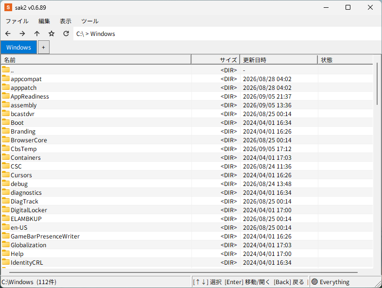
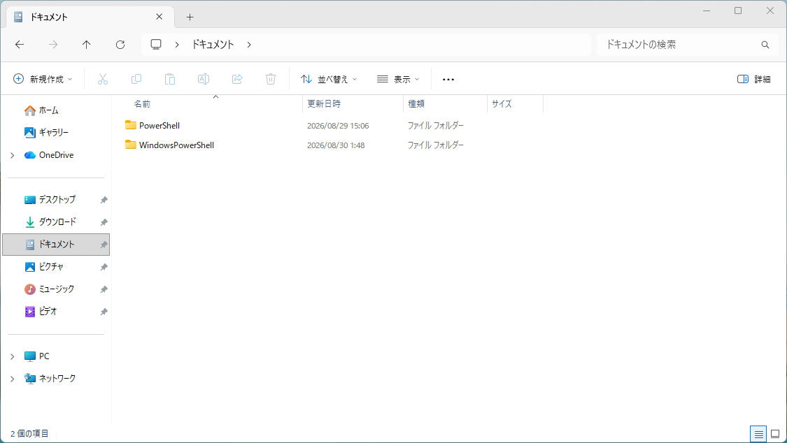

# sak2

**待たされない Windows 用ファイラー。**

OneDrive や NAS のように応答が遅い場所を開いても、画面が固まりません。
中身は裏で読み込み、一度見たフォルダは覚えています。

インストール不要。ZIP を展開して起動するだけで、レジストリには書き込みません。
設定・履歴・一覧の覚え書きは PC ごとの `%LOCALAPPDATA%\sak2` に置きます。
**やめるときは、展開したフォルダと `%LOCALAPPDATA%\sak2` を削除して終わりです。**

USB メモリなどで持ち運ぶときは、`sak2.exe` の隣に `portable` という名前の空のファイルを置くと、
設定も `sak2.exe` の隣に置きます（設定画面の「メンテナンス」→「設定を exe の隣に置く」でも切り替えられます）。

> ⚠ **動作の確認を進めている段階です。** 大切なファイルを扱う操作は、まずコピーで試してください。

| sak2 | Windows 標準のエクスプローラー |
|---|---|
|  |  |

---

## 何ができるか

- **2 画面・タブ** — コピー元と先を同時に開いておけます
- **お気に入り**・**フォルダごとの色分け**
- **上書きされるファイルはゴミ箱へ**（既定）— 上書き事故から救えます

操作は **Windows エクスプローラーとほぼ同じ**です。

**動作環境**: Windows 10 / 11（64bit）。
[Everything](https://www.voidtools.com/) があると検索が速くなり、フォルダサイズも出ますが、
**無くても普通に動きます**（検索は今のフォルダの中を順に探します）。

---

## 使い方

1. [Releases](https://github.com/kiosq911/sak2/releases) から ZIP をダウンロードする
2. **`C:\tool\sak2\` や `D:\apps\sak2\` など、自分で読み書きできる場所**に展開する
3. `sak2.exe` を起動する

> ⚠ **`C:\Program Files\` の下には置かないでください。**
> `sak2更新.bat` が新しい版へ入れ替えられなくなります。
>
> 設定は `%LOCALAPPDATA%\sak2` に保存されます（PC ごと）。USB メモリなどで持ち運んで使うときは、
> 設定画面で「設定を exe の隣に置く」を入れてください。

---

## 「WindowsによってPCが保護されました」と出たときは

「**詳細情報**」→「**実行**」で起動できます。以降は表示されません。

これは**ウイルスが見つかったという意味ではありません**。有償の署名証明書が
付いていないアプリすべてに出るもので、個人が無償で公開しているソフトの多くが
同じ状態です。

不安な場合は、各リリースのページに **VirusTotal のスキャン結果**と
**SHA-256** を載せているので確認してください。

---

## 通信について

**本体（`sak2.exe`）は通信しません。**

通信するのは、設定画面で「更新を確認」を押したときと、`sak2更新.bat` を
実行したときだけです。自動確認は**既定でオフ**。

例外：「別の PC を見る」（下の節・**既定でオフ**）を設定で入れた人だけ、本体が Windows の `ssh.exe` を起こします。「この PC の一覧を送り出す」を入れた人だけ、本体が隣の `sak2remote.exe` を起こし、それが `ssh.exe` で NAS へ一覧を送ります。
置き場をフォルダにした場合は ssh も起こさず、そのフォルダのファイルを読み書きするだけです（運ぶのは、そのフォルダを同期・共有している仕組みです）。
本体そのものに通信の部品は入っていません（`ssh.exe` の標準出力を読むだけです）。

---

## 別の PC を見る（遠隔の写し・見るだけ）

別の PC（Windows・Linux）のどこにどんなファイル・フォルダがあるかを、フォルダを開く感覚で見られます（既定は切）。

- **見るだけです。** 開く・コピー・移動・削除・名前の変更・ドラッグはできません（右クリックは「開く（フォルダ）」「パスをコピー」だけ）
- 場所は `名前:C:\Users\…`（Linux は `名前:/home/…`）と書きます。パス欄に打つか、お気に入りに入れて開きます
- フォルダを開くのは待ちません。手元のディスクに置いた**写し**（その PC の名前・大きさ・更新日時の一覧）を読むためです
- 一覧の運び方は2つあります。**かんたんな方は「置き場のフォルダ」**（次の節）、もう1つは ssh です
- 下の帯の右に「`名前` 接続中 12:34:56」（いつの写しか）が出ます。つながっていない間はサイズの欄が灰色になります
- 追わない場所（`C:\Windows`・`Program Files`・`AppData`・`node_modules`・`.git` の中など）は、一覧に「追っていない」と出て中は空です。設定画面で変えられます
- 写しは `%LOCALAPPDATA%\sak2\remote\<名前>.db` に置きます（大きさの目安：35万件で約18MB）

### かんたんな入れ方：置き場のフォルダ（ssh なし）

両方の PC から見えるフォルダ（NAS の共有フォルダ・OneDrive・Syncthing のフォルダなど、いま使っている同期・共有の場所）を「置き場」にします。見られる PC がそこへ一覧を書き出し、見る PC がそこから読みます。ssh も鍵もサーバーも要りません。

- ★**見られる PC のファイル名・フォルダ名・大きさ・更新日時が、そのフォルダへ出ます**（中身は出ません）。そのフォルダを同期・共有している先すべてに届きます。会社の PC から個人の OneDrive へ出すと社外へ出ることになります。社内の決まりを確かめてから入れてください
- 書き出すのは、見られる PC で sak2 を開いている間だけです（閉じると止まります。常駐しません）。下の帯の右に「送り出し中」と出ます
- **届く速さは同期の仕組みしだい**です（NAS の共有フォルダは数秒、OneDrive・Syncthing は数十秒〜数分）。下の帯の右の時刻が「いつの一覧か」です
- 置き場の `<名前>` フォルダには `current`・`alive`・`writer`・`sess-….bin` が入ります。1日ごとに全部を書き直し、古い `sess-….bin` は消します（大きくなり続けません）
- 1つの名前に書く PC は1台です。別の PC が同じ名前で書いていると、後から来た方は止まり、下の帯に「送り出し失敗：別の PC（…）が同じ名前で…」と出ます

1. **見られる PC**：`sak2.exe` の隣に同梱の `sak2remote.exe` があることを確かめる。設定画面の「外部のソフト」→「遠隔の写し」で「この PC の一覧を置き場へ送り出す」を入れ、見る側で使う名前と「置き場のフォルダ」（「参照...」で選ぶ）を決める。「書き出す先」に出た場所を確かめて保存する（開いている sak2 にもそのまま効きます）
2. **見る PC**：「別の PC のフォルダを見る」を入れ、「ホストを足す」で名前（1 で決めた名前）を書き、「置き場のフォルダから読む」に同じフォルダ（この PC から見える場所）を選んで保存する
3. パス欄に `名前:C:\` と打って開く

置き場のフォルダが見えないとき・まだ一覧が届いていないときは、下の帯の中ほどに「置き場のフォルダに一覧が無い」と出ます。

### ssh で入れる

- その PC の場所を開いている間だけ ssh でつなぎ、**約10秒ごと**に変化を受け取ります。開いていないときはつなぎません（写しが1日より古ければ、sak2 を開いたときに1回だけ取り直します）

1. **見られる PC** に送り手を置く
   - Windows：同梱の `sak2remote.exe` を置く（例 `C:\tool\sak2\sak2remote.exe`）。[Everything](https://www.voidtools.com/) があれば最初の取得が速くなります（無くても動きます）
   - Linux：同梱の `sak2remote.py` を置く（例 `~/sak2/sak2remote.py`。Python 3 だけで動き、入れる物はありません）
   - 送り手は**つないでいる間だけ**動き、切れたら終わります（常駐しません）。ファイルの中身は開かず、何も書きません
2. **見る PC** から、見られる PC へ **鍵で** ssh できるようにする（`ssh 名前` がパスワードを聞かずにつながること。Windows 10/11 の OpenSSH クライアントを使います。見られる側が Windows なら OpenSSH サーバーが要ります）
3. 設定画面の「外部のソフト」→「遠隔の写し」で「別の PC のフォルダを見る」を入れ、「ホストを足す」で名前・ssh でつなぐ先・送り手の場所を書く（Linux なら場所を `.py` で終える）。sak2 を開き直す
4. パス欄に `名前:C:\` と打って開く

うまくつながらないときは、下の帯の中ほどに理由（ssh のエラーの最後の行）が出ます。

### 外から入れない PC（会社の PC など）を ssh の NAS 経由で見る

外から ssh で入れない PC は、上の「置き場のフォルダ」がかんたんです。ssh で NAS へ出せる場合は、その PC から NAS（いつも動いている Linux。ssh で入れて Python 3 があるもの）へ一覧を**送り出し**、見る側は NAS から読むこともできます。その PC に外から入る口は作りません。

- ★**その PC のファイル名・フォルダ名・大きさ・更新日時が NAS へ出ます**（中身は出ません）。会社の PC では社内の決まりを確かめてから入れてください
- 送り出すのは、その PC で sak2 を開いている間だけです（閉じると止まります。常駐しません）。下の帯の右に「送り出し中」と出ます
- NAS は、届いた一覧を `~/sak2/hub/<名前>/` に置くだけです（ssh がつながっている間だけ動きます）

1. NAS に同梱の `sak2remote.py` を置く（例 `~/sak2/sak2remote.py`）
2. 送り出す PC：`sak2.exe` の隣に同梱の `sak2remote.exe` があることを確かめ、NAS へ鍵で ssh できるようにする。設定画面の「この PC の一覧を置き場へ送り出す」を入れ、見る側で使う名前・置き場（ssh でつなぐ先）・送る場所・追わない場所を書く（「置き場のフォルダ」は空のまま）。sak2 を開き直す
3. 見る PC：「ホストを足す」で、名前（送り出す PC で書いた名前）・ssh でつなぐ先（NAS）・相手の送り手の場所（NAS の `sak2remote.py`）を書き、「NAS の置き場から読む」を入れる

送り出している PC が閉じていても、最後に送った一覧が見えます。下の帯の右は「`名前` 送り元停止 時刻」になります。

---

## 「localサイズ」の列（OneDrive の手元の容量）

設定画面の「一覧に「localサイズ」の列を出す」を入れると、一覧に「localサイズ」の列が足されます（既定は切）。

- **数えるもの**：OneDrive の**クラウドだけのファイル**（雲の印）を除いた、手元のディスクにある分の大きさです。今までの「サイズ」の列（クラウドだけの分も含む全体）はそのまま残ります
- ファイルの行は、手元にあればそのファイルの大きさ、クラウドだけなら `0 B`
- フォルダの行は、その下の**全部の階層**の手元の分の合計です。「localサイズ」で並べると、手元のディスクを使っているフォルダから順にたどれます
- OneDrive の中のフォルダ（SharePoint のライブラリの同期を含む）は、**[Everything](https://www.voidtools.com/) が要ります**。裏で聞いて埋めるので待たされません（取れるまでは `<DIR>`。数十万件のフォルダでは数十秒かかることがあります）。Everything が無いときは `<DIR>` のままです
- OneDrive を中に含むフォルダ（`C:\Users\<名前>` など）は、「サイズ」の列の値からクラウドだけの分を引いた値です。OneDrive の中の値が揃うまでは `<DIR>` です
- OneDrive と関わらないフォルダでは「サイズ」の列と同じ値です
- 「サイズの横棒を出す」を入れていると、この列にも同じ横棒が出ます（長さは、一覧の中の localサイズの合計に対する割合）
- Windows の「ディスク上のサイズ」とは違います（クラスタ単位に切り上げず、ファイルの大きさをそのまま足します）
- サイズが出ないときは、環境変数 `SAK2_DIAG_LOG` に記録のファイルのパス（例：`%TEMP%\sak2_diag.txt`。一覧で開いているフォルダの外）を入れて sak2 を起動すると、Everything とのやり取りが1行ずつ書かれます。不具合の報告に添えてください（入れていないときは何も書きません）

---

## Windows と動きが違うところ

**多くは設定で標準へ戻せます。**

| 項目 | sak2 の既定 | Windows 標準 | 設定場所 |
|---|---|---|---|
| 上書きされるファイル | **ゴミ箱へ送ってから上書き** | 直接消して上書き | 設定画面「ファイル操作」 |
| 隠しファイル | **表示する** | 表示しない | 設定画面「表示」／上のメニュー「表示」・右クリックの「隠しファイルを表示」 |
| 同名フォルダを作ったとき | **「名前 (2)」を付けて作る** | エラーで知らせる | 設定画面「ファイル操作」 |
| OneDrive の状態 | 「状態」列に記号1文字 | アイコンの重ね表示 | 設定画面「表示」 |
| 一覧の見出し | **列と列の間に薄い縦線** | 線を引かない | （戻せません） |
| ヘルプ（F1） | 何も起きない | Web 検索が開く | （戻せません） |
| 右クリックの「送る」 | SendTo フォルダーの**ショートカットだけ**を並べる（「圧縮 (zip 形式) フォルダー」「デスクトップ (ショートカットを作成)」「メールの受信者」「ドキュメント」は出ない。ZIP は右クリックの「ZIP ファイルに圧縮する」で作れる） | SendTo の中身を全部並べる | （戻せません） |
| Everything が無いときの検索（Ctrl+F） | 今のフォルダとその下を**名前だけ**で探し、見つけた分から出す。**先頭の 100 件まで**。ジャンクション・シンボリックリンクの先へは入らない | 今のフォルダの下を探し、名前のほかにファイルの中身も照らす（インデックスのある場所）。件数の上限は無い | （戻せません） |
| サイズ・localサイズの列で並べたときのフォルダ | フォルダの大きさを出しているときは、**出している大きさの順**。まだ分からないフォルダ（`<DIR>`）は昇順でも降順でもフォルダの最後 | フォルダの大きさを出さないので、フォルダは名前の順 | 設定画面「外部のソフト」の「フォルダサイズ」を切ると Windows 標準と同じ（localサイズの列は出さなければ並べ替えにも使われない） |
| フォルダのツリー（左の列） | いちばん上はドライブ。ネットワークの場所は、そこを開いたときに足す。「ホーム」「PC」「ネットワーク」の項目は無い。開く印は ⊞ の形 | 「ホーム」「PC」「ネットワーク」の下にドライブ・フォルダが並ぶ。開く印は ▶ の形 | （戻せません。ツリーごと隠すのは上のメニュー「表示」） |
| 右クリックの「すべて展開」 | **窓を出さず**、ZIP と同じ名前のフォルダー（在れば「名前 (2)」）へすぐ展開する。進み具合の窓は出ない | 展開先を選ぶ窓と進み具合の窓が出る | （戻せません） |
| 一覧の見出しの右クリック | 出し入れできる列は「種類」「作成日時」「localサイズ」だけ。名前・サイズ・更新日時・状態は外せない。「その他...」は無い | 多くの列から選べ、「その他...」で列を足せる | （戻せません。選んだ列は設定画面の同じ項目にも出る） |

表に無い挙動は Windows 標準に合わせてあります。

---

## 同梱ファイル

| ファイル | 役割 |
|---|---|
| `sak2.exe` | 本体 |
| `sak2config.exe` | 設定画面 |
| `sak2report.exe` | 異常終了したときの報告画面 |
| `sak2remote.exe` | 「別の PC を見る」の送り手（見られる Windows の PC に置く。使わなければ要りません） |
| `sak2remote.py` | 同じ・Linux 用 |
| `sak2更新.bat` | 新しい版のダウンロードと入れ替え |
| `LICENSE` | 使用許諾条件 |
| `README.txt` | この説明（の抜粋） |

使用しているライブラリの権利表示は
[`THIRD_PARTY_LICENSES.txt`](https://github.com/kiosq911/sak2/blob/main/docs/THIRD_PARTY_LICENSES.txt)
にあります（315件・3,331行あるため ZIP には入れていません）。

---

## 更新のしかた

設定画面の「メンテナンス」→「更新を確認」、または `sak2更新.bat` を実行します。

sak2 を開いたままでも実行できます。

- 手が空いていれば、`sak2更新.bat` が sak2（と設定画面）に閉じてもらい、入れ替えてから開き直します。タブや窓の配置は、×で閉じたときと同じく残ります
- コピー・移動・名前の変更などの最中や、設定画面に保存していない変更があるときは、何も変えずに「更新できませんでした」の窓を出して止まります。終わってから、もう一度実行してください
- sak2 を無理に終わらせることはしません（写している途中のファイルが半分のまま残るため）
- この版より前の sak2 を開いているときは閉じずに入れ替えます。開いている sak2 は前の版のまま動き、閉じて開き直すと新しい版になります

前の版は `sak2.exe.bak`（前の版を開いたままのときは `.bak2` など）として残るので、問題があれば戻せます。

手で入れ替えるときも、同じ順にしてください（`sak2config.exe`・`sak2report.exe` も同じです）。

1. 前の `sak2.exe.bak` をゴミ箱へ送る。**使用中で送れないとき（前の版がまだ開いている）は、そのまま残す**
2. いまの `sak2.exe` の名前を `sak2.exe.bak` に変える（開いていても変えられます）。
   1 で `.bak` が残ったときは、`sak2.exe.bak2` など空いている名前に変える
3. 新しい `sak2.exe` を置く

`sak2.exe` の上へ直接上書きしないでください。前の版の控えが無くなります。
残った古い控えは、その版を閉じた後でゴミ箱へ送ってください（`sak2更新.bat` は次に実行したときに片付けます）。

---

## 不具合の報告・要望

[Issues](https://github.com/kiosq911/sak2/issues) へお願いします。
Windows のバージョン、sak2 のバージョン（タイトルバーに出ています）、
何をしたときに何が起きたかを書いていただけると助かります。

---

## ライセンス

**無償で使えます。個人利用・業務利用を問いません。**

- ✅ 自由に使える（職場の PC でも、連絡不要）
- ✅ 内容を変えないままなら、自由に再配布できる
- ✅ 紹介・レビュー・実況は自由（広告が付いていても構いません）
- ❌ 販売・有償配布、改造版の配布は禁止

詳しくは同梱の `LICENSE` をご覧ください。
**ソースコードは公開していません。**
